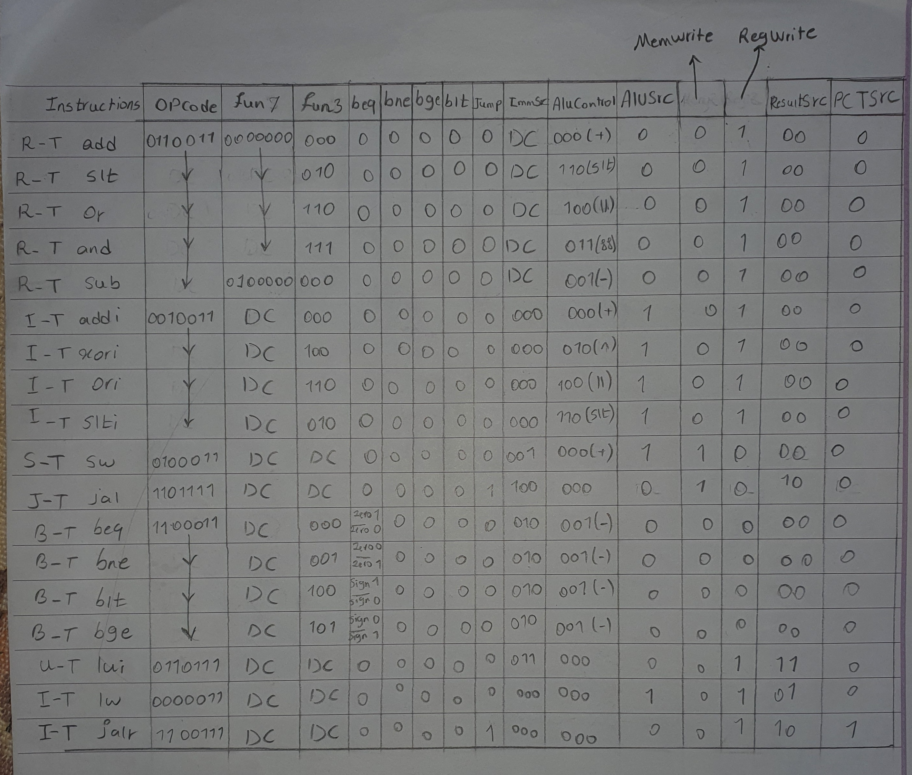

# RISC-V Pipeline Processor

A complete implementation of a RISC-V processor with Pipeline architecture in SystemVerilog for simulation in ModelSim.

## 📋 Features

- **5-Stage Pipeline**: Fetch, Decode, Execute, Memory, Writeback
- **Hazard Detection**: Detection and management of Data Hazards and Control Hazards
- **Forwarding Unit**: Forwarding to reduce Stalls
- **RISC-V Instruction Support**:
  - Load/Store: `LW`, `SW`
  - Arithmetic: `ADD`, `SUB`, `ADDI`
  - Logical: `AND`, `OR`, `XOR`, `ANDI`, `ORI`, `XORI`
  - Comparison: `SLT`, `SLTI`
  - Branch: `BEQ`, `BNE`, `BLT`, `BGE`
  - Jump: `JAL`, `JALR`
  - Upper Immediate: `LUI`

## 📁 Project Structure

```
CA4/
├── src/              # Main SystemVerilog source files
│   ├── RISCV.sv      # Main processor module
│   ├── controller.sv # Control unit
│   ├── data_path.sv  # Datapath
│   └── modules.sv    # Helper modules (ALU, Memory, Register File, ...)
├── test/             # Test files
│   └── riscv_tb.sv   # Main testbench
├── data/             # Data files
│   ├── instructions.txt  # Program instructions
│   └── array.txt         # Memory data
├── docs/             # Documentation and architecture diagrams
│   ├── Controller.jpg        # Control unit architecture diagram
│   ├── Datapath (1).jpg      # Complete datapath diagram
│   ├── Hazard Unit 1.jpg     # Hazard unit diagram (part 1)
│   └── Hazard Unit 2.jpg     # Hazard unit diagram (part 2)
├── problem_statement/ # Problem statement files
│   ├── problem_statement_fa.pdf  # Original problem statement (Persian)
│   └── problem_statement_en.md   # Problem statement (English)
└── README.md         # This file
```

## 🚀 Usage

### Prerequisites

- ModelSim or QuestaSim
- SystemVerilog support

### Running Simulation

1. Open the project in ModelSim:
   ```
   File > Open > riscv_pipeline.mpf
   ```

2. Or compile files manually:
   ```tcl
   vlog src/*.sv test/*.sv
   ```

3. Run simulation:
   ```tcl
   vsim -voptargs=+acc riscv_tb
   run -all
   ```

## 🔧 Main Modules

### RISCV.sv
Main module that connects all processor components:
- Controller
- Datapath
- Hazard Unit

### controller.sv
Control unit that generates control signals based on opcode and funct.

### data_path.sv
Datapath including:
- Program Counter
- Instruction Memory
- Register File
- ALU
- Data Memory
- Pipeline Registers

### modules.sv
Helper modules:
- `ALU`: Arithmetic Logic Unit
- `registerFile`: 32-bit register file
- `instructionMemory`: Instruction memory
- `dataMemory`: Data memory
- `hazardUnit`: Hazard detection unit
- `extend`: Sign extension
- Pipeline Registers: `pipeFD`, `pipeDE`, `pipeEM`, `pipeMW`

## 📸 Architecture Diagrams

This section contains detailed architecture diagrams of the processor components. These diagrams illustrate the design and connections between different modules.

### Controller Architecture

The control unit generates all control signals based on the instruction opcode, funct3, and funct7 fields.



**Description**: This diagram shows the control unit structure, including:
- Instruction decoding logic
- Control signal generation for different instruction types
- ALU control signal generation
- Branch and jump control logic

### Datapath Architecture

The complete datapath showing all pipeline stages and data flow.

.jpg)

**Description**: This diagram illustrates:
- 5-stage pipeline structure (Fetch, Decode, Execute, Memory, Writeback)
- Data paths between pipeline stages
- Register file connections
- ALU and memory interfaces
- Pipeline registers and their connections

### Hazard Unit Architecture

The hazard detection and forwarding unit handles data and control hazards.

#### Hazard Unit - Part 1


**Description**: This diagram shows:
- Data hazard detection logic
- Forwarding path detection
- Stall signal generation

#### Hazard Unit - Part 2


**Description**: This diagram illustrates:
- Forwarding multiplexer control
- Load-use hazard detection
- Pipeline flush control
- Forwarding from Memory and Writeback stages

## 📊 Pipeline Stages

1. **Fetch (F)**: Read instruction from Instruction Memory
2. **Decode (D)**: Decode instruction and read registers
3. **Execute (E)**: Perform ALU operations
4. **Memory (M)**: Access Data Memory
5. **Writeback (W)**: Write result to Register File

## 🛡️ Hazard Handling

### Data Hazards
- **Forwarding**: Forwarding from M and W stages to E
- **Stalling**: Stall on Load-Use Hazard

### Control Hazards
- **Flush**: Flush instructions after Branch/Jump
- **Branch Prediction**: Use Branch Taken

## 📝 Supported Instructions

| Instruction | Opcode | Description |
|-------------|--------|-------------|
| LW | 0000011 | Load Word |
| SW | 0100011 | Store Word |
| ADD | 0110011 | Add |
| SUB | 0110011 | Subtract |
| ADDI | 0010011 | Add Immediate |
| AND | 0110011 | And |
| OR | 0110011 | Or |
| XOR | 0110011 | Xor |
| SLT | 0110011 | Set Less Than |
| BEQ | 1100011 | Branch if Equal |
| BNE | 1100011 | Branch if Not Equal |
| BLT | 1100011 | Branch if Less Than |
| BGE | 1100011 | Branch if Greater or Equal |
| JAL | 1101111 | Jump and Link |
| JALR | 1100111 | Jump and Link Register |
| LUI | 0110111 | Load Upper Immediate |

## 🐛 Bug Fixes

Issues identified and fixed:
- ✅ Case sensitivity in variable names
- ✅ Type mismatch in `ResultSrcEHazard`
- ✅ Incorrect bit ranges in `registerFile`
- ✅ SLT logic for signed comparison
- ✅ Removed duplicate assignments

## 📄 License

This project is for educational purposes.
